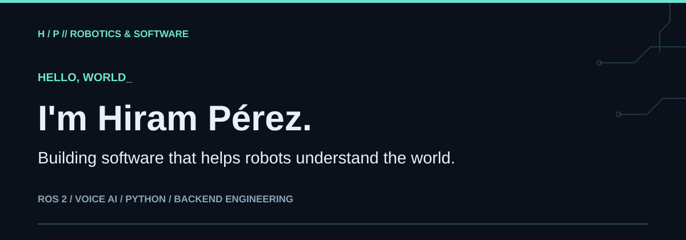
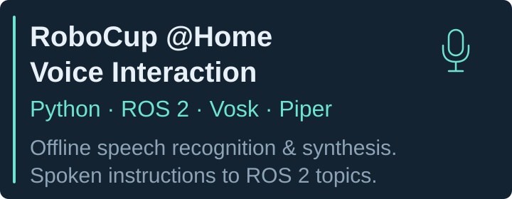

<picture>
  <source media="(max-width: 600px)" srcset="assets/hero-mobile.svg">
  
</picture>

# Robotics Software Developer | Backend Engineer

I personally developed the **ROS 2 voice-interaction module for RoboCup @Home 2026**, integrating offline speech recognition with Vosk, speech synthesis with Piper, keyword-based dialogue, and ROS 2 topic outputs. I also build authenticated backend applications with FastAPI and Spring Boot.

## About Me

I'm a seventh-semester **Computer Systems Engineering student at Universidad de Montemorelos**, with expected graduation in **May 2028**.

My work connects an interest in human–robot interaction with hands-on software development, from speech-processing modules to authenticated APIs and web applications.

## Featured Robotics Project

I personally developed the project-owned voice-module code for **RoboCup @Home 2026**, using **Python, ROS 2, Vosk, and Piper**.

- Offline speech recognition with Vosk and speech synthesis with Piper.
- Keyword-based dialogue, command confirmation, and ASR/TTS coordination.
- ROS 2 topic bridges that publish object and location names for external consumers.

The public repository preserves the April 2026 implementation in a standalone workspace with provenance documentation and a simulated demo.

[View the public RoboCup @Home voice-module repository](https://github.com/Raphinha1/robocup-at-home-voice-2026)

## Tech Stack

- **Languages:** Python, Java, TypeScript, C++
- **Robotics & embedded:** ROS 2, ESP32
- **Backend:** Spring Boot, FastAPI
- **Development tools:** Linux, Git

## Selected Projects

A local-first Android tracker for workouts, nutrition, and recovery, built with Kotlin, Jetpack Compose, and Room. Includes exercise routines, meal planning, manual sleep tracking, and local backups. The public source documents current feature limitations and privacy considerations.

[View Viresta Android](https://github.com/Raphinha1/viresta-android)

A restaurant operations application built with Java 21, Spring Boot, Thymeleaf, and PostgreSQL. Includes point of sale, kitchen display, tables and reservations, recipes, cash shifts, reporting, and staged inventory workflows. Published as a source-only portfolio snapshot, not a production-ready deployment.

[View Ventro Resto](https://github.com/Raphinha1/ventro-resto)

An offline-first family grocery PWA with a categorized product catalog, pending list, active purchase and optional prices. It stores shopping actions locally, queues them for ordered synchronization when connectivity returns, and supports authorization and revocation of paired devices. Catalog changes require a connection.

[View offline-shopping-list](https://github.com/Raphinha1/offline-shopping-list)

An academic contact manager with an authenticated REST API, JWT authentication, per-user contact access, and server-rendered Jinja2 views.

[View agenda-fastapi](https://github.com/Raphinha1/agenda-fastapi)

An academic contact manager built with Spring MVC, Spring Security, and JPA. It combines JWT-protected API endpoints, per-user contact access, and Thymeleaf pages.

[View agenda-springboot](https://github.com/Raphinha1/agenda-springboot)

An academic text editor with a React frontend and Spring Boot REST API, HTTP-session authentication, document creation and editing, and TXT import/export.

[View editor-texto-saas](https://github.com/Raphinha1/editor-texto-saas)

## Currently Exploring

- **RoboCup @Home 2027:** preparing for the next competition cycle and exploring future directions for human–robot interaction.
- **Havva:** a research project I'm exploring, with a focus on shaping its research direction.

## Recognition

Recognition at the **Torneo Mexicano de Robótica 2026**, **Federación Mexicana de Robótica**.

## Connect

I'm interested in robotics collaborations, applied AI research, and backend development opportunities.

- [LinkedIn — Hiram Rafael Pérez](https://www.linkedin.com/in/hiram-rafael-perez/)
- [GitHub — Raphinha1](https://github.com/Raphinha1)
- [Academic portfolio — Universidad de Montemorelos](https://portafoliosfit.um.edu.mx/hiramperez)
